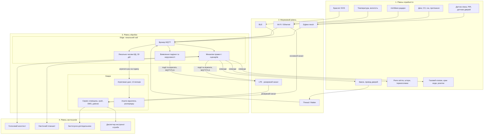
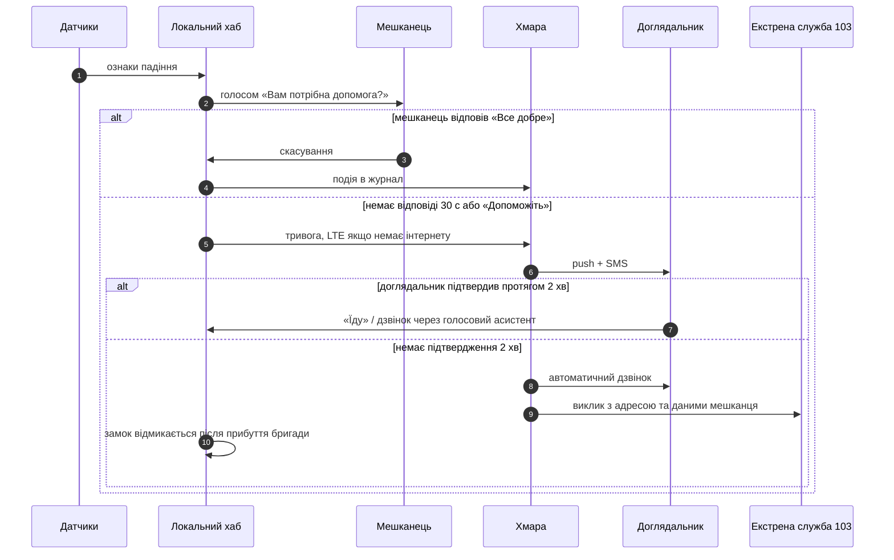

# Розумний будинок для людини з обмеженою мобільністю

Проєктний документ IoT-системи. Практична робота, варіант 5.

## Зміст

1. [Постановка задачі](#1-постановка-задачі)
2. [Вимоги до системи](#2-вимоги-до-системи)
3. [Підсистеми](#3-підсистеми)
4. [Склад системи](#4-склад-системи)
5. [Архітектура](#5-архітектура)
6. [Сценарії спільної роботи підсистем](#6-сценарії-спільної-роботи-підсистем)
7. [Виявлення нештатних ситуацій і сповіщення](#7-виявлення-нештатних-ситуацій-і-сповіщення)
8. [Розміщення обробки: edge, fog, хмара](#8-розміщення-обробки-edge-fog-хмара)

---

## 1. Постановка задачі

Об'єкт — однокімнатна квартира або невеликий будинок площею до 60 м², у якому мешкає одна людина з обмеженою мобільністю (користувач крісла колісного або людина, що пересувається з ходунками). Мешканець має повний когнітивний контроль, але обмежений у фізичних діях: дотягнутися до вимикача, відчинити важкі двері, швидко дістатися до вхідних дверей, підвестися після падіння.

Мета системи — підвищити самостійність мешканця: дати змогу керувати житлом голосом або з планшета, автоматизувати рутинні дії та гарантувати, що нештатна ситуація (падіння, тривала відсутність руху, пожежа) буде виявлена й передана доглядальнику без участі самого мешканця.

Система відповідає трьом ознакам IoT:

| Ознака | Як реалізовано |
|---|---|
| Ідентифікованість | кожен вузол має унікальний ідентифікатор і власні облікові дані, видані під час провізіонування |
| Зв'язність | вузли передають телеметрію та приймають команди через локальний хаб |
| Автономність дії | сценарії та виявлення нештатних ситуацій виконуються за правилами без команди людини |

## 2. Вимоги до системи

### 2.1. Функціональні

- **Ф1.** Керування освітленням, кліматом, шторами, дверима та замком голосом, з планшета або смартфона.
- **Ф2.** Автоматичне виявлення падіння мешканця та тривалої відсутності руху.
- **Ф3.** Багаторівневе сповіщення: мешканець → доглядальник → екстрена служба.
- **Ф4.** Дистанційне відчинення вхідних дверей для доглядальника або бригади швидкої допомоги.
- **Ф5.** Виявлення диму, чадного газу, витоку газу та води з автоматичною реакцією.
- **Ф6.** Щонайменше три сценарії спільної роботи підсистем (розділ 6).

### 2.2. Нефункціональні

| Код | Вимога | Значення |
|---|---|---|
| Н1 | Затримка «команда → дія» для освітлення, дверей, замка | ≤ 1 с |
| Н2 | Затримка «подія падіння → перший сигнал мешканцю» | ≤ 3 с |
| Н3 | Затримка «підтверджена тривога → сповіщення доглядальника» | ≤ 30 с |
| Н4 | Робота критичних функцій без інтернету | обов'язкова |
| Н5 | Робота хаба й зв'язку без мережевого живлення | ≥ 4 год |
| Н6 | Автономність батарейних датчиків | ≥ 1 рік |
| Н7 | Сирі дані про рух не залишають житло | обов'язкова |

## 3. Підсистеми

Система складається з п'яти підсистем. Вони об'єднані спільним локальним хабом, але кожна має власну зону відповідальності.

| № | Підсистема | Призначення |
|---|---|---|
| П1 | Моніторинг стану мешканця | виявлення присутності, падіння, тривалої нерухомості; кнопка SOS |
| П2 | Доступ і пересування | автоматичні двері, електронний замок, відеодомофон |
| П3 | Освітлення та мікроклімат | світло, опалення, кондиціювання, штори |
| П4 | Побутова безпека | дим, CO, газ, протікання, контроль плити |
| П5 | Інтерфейс керування | голосовий асистент, настінний планшет, застосунок доглядальника |

## 4. Склад системи

| Пристрій | Підсистема | Що вимірює або робить | Де розміщено | Зв'язок |
|---|---|---|---|---|
| mmWave-радар присутності з детекцією падіння | П1 | присутність, положення тіла, падіння, дихальна активність | стеля спальні, ванної, кухні, коридору (4 шт.) | Wi-Fi / Thread |
| Носимий браслет з акселерометром і кнопкою SOS | П1 | різке прискорення та удар, ручний виклик допомоги | зап'ястя мешканця | BLE |
| Датчик тиску під матрацом | П1 | перебування в ліжку | ліжко | Zigbee |
| PIR-датчик руху | П1, П3 | рух у прохідних зонах | коридор, вхід (2 шт.) | Zigbee |
| Привід автоматичного відчинення дверей | П2 | відчиняє та зачиняє двері | вхідні двері, двері ванної | Zigbee + сухий контакт |
| Електронний замок | П2 | замикання / відмикання вхідних дверей | вхідні двері | Thread (Matter) |
| Датчик відчинення дверей | П2 | стан дверей | вхідні двері, балкон | Zigbee |
| Відеодомофон | П2 | відео з входу, двостороння розмова | зовні біля вхідних дверей | Wi-Fi |
| Розумні реле освітлення | П3 | вмикання та диммування світла | розподільчі коробки кожного приміщення | Zigbee |
| Аварійні світильники з акумулятором | П3 | підсвічування шляху при знеструмленні | коридор, спальня, ванна | автономно |
| Термостат і термоголовки | П3 | температура, керування опаленням | кожне приміщення | Zigbee |
| Датчик температури й вологості | П3 | мікроклімат | кожне приміщення | Zigbee |
| Привід штор | П3 | відкриття та закриття штор | вікна спальні й кімнати | Zigbee |
| Датчик диму та CO | П4 | задимлення, чадний газ | стеля кухні, спальні, коридору | Zigbee |
| Датчик витоку газу + електроклапан | П4 | концентрація газу; перекриття подачі | кухня, газова труба на вводі | Zigbee + реле |
| Датчик протікання + кран із приводом | П4 | вода на підлозі; перекриття води | ванна, кухня, ввід водопроводу | Zigbee |
| Розумна розетка з вимірюванням струму | П4 | контроль і відключення плити, чайника | кухня | Zigbee |
| Голосовий асистент з локальним розпізнаванням | П5 | голосові команди, голосові запитання системи | кімната, спальня | Wi-Fi |
| Настінний планшет | П5 | панель керування з великими елементами, відео з домофона | кімната, на висоті 0,9–1,1 м (зона досяжності з крісла) | Wi-Fi |
| Локальний хаб (міні-ПК) з ДБЖ | усі | координатор Zigbee/Thread, брокер MQTT, механізм правил, локальна БД | технічна ніша | Ethernet, Wi-Fi, LTE-модем |

## 5. Архітектура

### 5.1. Чотирирівнева модель

### 5.2. Зони відповідальності рівнів

| Рівень | Відповідальність у цій системі | Технології |
|---|---|---|
| Сприйняття | спостереження за мешканцем і середовищем, фізичні дії (двері, світло, клапани) | mmWave-радари, акселерометр, датчики Zigbee, приводи |
| Мережа | доставка телеметрії та команд усередині житла; резервний вихід назовні | Zigbee mesh для батарейних датчиків, Thread/Matter для замка, BLE для браслета, LTE як резерв |
| Обробка | правила, сценарії, виявлення нештатних ситуацій — локально; сповіщення та довгострокова аналітика — у хмарі | MQTT, механізм правил, часова БД |
| Застосунки | керування для мешканця, статус і тривоги для доглядальника | голосовий інтерфейс, планшет, мобільний застосунок |

### 5.3. Вибір протоколів

- **Zigbee** — для батарейних датчиків: mesh-топологія покриває всю квартиру, низьке енергоспоживання забезпечує вимогу Н6.
- **Thread / Matter** — для замка: сумісність пристроїв різних виробників, вбудоване шифрування та автентифікація.
- **BLE** — для браслета: мінімальне споживання, працює з хабом напряму; браслет також визначає, чи мешканець удома (є / немає BLE-зв'язку).
- **Wi-Fi** — для пристроїв із мережевим живленням та великим трафіком (радари, домофон, планшет).
- **LTE** — резервний канал хаба на випадок відмови домашнього інтернету.

## 6. Сценарії спільної роботи підсистем

### Сценарій 1. «Ранковий підйом»

Підсистеми: П1, П3, П5.

1. Датчик ліжка фіксує, що мешканець сів на краю ліжка після 06:00.
2. Світло у спальні вмикається на 30 %, потім плавно до 70 % за 2 хв; підсвічується шлях до ванної.
3. Штори відкриваються, якщо надворі світло.
4. Опалення у ванній переходить у комфортний режим (+24 °C).
5. Голосовий асистент повідомляє погоду та нагадування про ліки.

### Сценарій 2. «Прихід доглядальника або гостя»

Підсистеми: П2, П5, П1.

1. Відвідувач натискає кнопку домофона — на планшеті та в голосовому асистенті з'являється відео й голос.
2. Мешканець відповідає «Відчинити» голосом або торкається кнопки на планшеті.
3. Замок відмикається, привод відчиняє двері; через 20 с після проходу (датчик дверей + PIR) двері зачиняються, замок замикається.
4. Для доглядальника із зареєстрованим смартфоном можливий вхід без участі мешканця — лише за подвійного підтвердження (розділ 10).

### Сценарій 3. «Нічний вихід»

Підсистеми: П1, П3.

1. Між 23:00 і 06:00 датчик ліжка фіксує підйом.
2. Підсвічування підлоги та коридору вмикається на 10 % — без засліплення.
3. Двері ванної відчиняються приводом, коли радар фіксує наближення.
4. Якщо мешканець не повернувся в ліжко за 40 хв, запускається перевірка стану (розділ 7).

### Сценарій 4. «Пожежа або витік газу»

Підсистеми: П4, П2, П3, П5, П1.

1. Датчик диму / CO / газу фіксує перевищення порогу.
2. Газовий клапан закривається, розетки на кухні знеструмлюються.
3. Світло скрізь вмикається на 100 %, замок відмикається, привод відчиняє вхідні двері.
4. Голосовий асистент повідомляє, що сталося, і куди рухатися.
5. Доглядальник і екстрена служба отримують сповіщення негайно, без етапу підтвердження.

## 7. Виявлення нештатних ситуацій і сповіщення

### 7.1. Падіння

Падіння визначається злиттям даних двох незалежних джерел:

- **mmWave-радар** фіксує різку зміну висоти тіла та подальше перебування на рівні підлоги понад 10 с;
- **браслет** фіксує пік прискорення та відсутність вертикального положення.

| Ситуація | Рішення |
|---|---|
| спрацювали обидва джерела | підтверджене падіння |
| спрацювало одне джерело | ймовірне падіння, обов'язкова перевірка голосом |
| натиснута кнопка SOS | тривога одразу, без перевірки |

Використання двох джерел зменшує кількість хибних тривог (наприклад, браслет упав на підлогу) і закриває сліпі зони (мешканець без браслета у ванній).

### 7.2. Тривала відсутність руху

Пороги задаються окремо для приміщень і часу доби, бо 40 хв нерухомості в ліжку вночі — норма, а у ванній — ознака проблеми.

| Зона | День (07:00–23:00) | Ніч (23:00–07:00) |
|---|---|---|
| Ванна кімната | 40 хв | 40 хв |
| Кухня, кімната | 3 год | — |
| Ліжко | 3 год після звичного часу підйому | 10 год |
| Немає руху ніде, вхідні двері не відчинялися, браслет у зоні BLE | 2 год | — |

Якщо вхідні двері відчинялися і браслет вийшов із зони BLE, система вважає, що мешканець пішов з дому, і перевірку не запускає.

### 7.3. Порядок сповіщення

Рівні ескалації:

| Рівень | Кому | Канал | Коли |
|---|---|---|---|
| 0 | мешканець | голос, планшет | одразу після виявлення |
| 1 | доглядальник | push, SMS | немає відповіді 30 с |
| 2 | доглядальник | автоматичний дзвінок | немає підтвердження 2 хв |
| 3 | екстрена служба | дзвінок оператора або сервісу | немає реакції на рівні 2; одразу при пожежі |

## 8. Розміщення обробки: edge, fog, хмара

У системі використано два рівні обробки: **edge** (локальний хаб у квартирі) і **хмара**. Окремий fog-рівень не потрібен: в одній квартирі немає кількох локальних мереж, які варто агрегувати, і роль проміжного вузла виконує сам хаб.

| Функція | Де | Вимога, що визначила вибір |
|---|---|---|
| Керування світлом, дверима, замком | edge | Н1: затримка ≤ 1 с; шлях до хмари й назад додає 100–500 мс і залежить від інтернету |
| Виявлення падіння, перевірка голосом | edge | Н2: ≤ 3 с до першого сигналу; Н4: має працювати без інтернету |
| Реакція на дим, газ, протікання | edge | безпечний стан має наставати навіть при повній відмові зовнішнього зв'язку |
| Виявлення тривалої нерухомості | edge | Н7: сирі дані про рух не залишають житло |
| Доставка сповіщень (push, SMS, дзвінок) | хмара | Н3: ≤ 30 с — допустимо; потрібна інтеграція з операторами зв'язку |
| Аналіз змін розпорядку за тижні й місяці | хмара | затримка не критична, потрібна довга історія та обчислювальні ресурси |
| Звіти для доглядальника | хмара | доступ ззовні, з будь-якого пристрою |

**Головна вимога, що визначила архітектуру, — Н2 + Н4:** система виявлення падіння повинна реагувати за секунди і не залежати від інтернету. Тому вся логіка безпеки виконується на edge, а хмара отримує лише події та годинні агрегати.

### 8.1. Оцінка обсягу телеметрії

| Джерело | Кількість | Періодичність | Записів на добу |
|---|---|---|---|
| Радари — агрегат стану | 4 | 1 раз на 10 с | 34 560 |
| Температура, вологість | 4 | 1 раз на 5 хв | 1 152 |
| PIR, двері, ліжко — події | ~10 | за подією, ~50 / добу | ~500 |
| Дим, газ, протікання — heartbeat | 7 | 1 раз на годину | 168 |
| Браслет | 1 | 1 раз на 30 с | 2 880 |
| **Разом на edge** | | | **≈ 39 300** |

При розмірі запису ~200 байт це ≈ 8 МБ на добу, ≈ 240 МБ за 30 діб — локальна БД хаба легко це вміщує. У хмару передаються годинні агрегати та події — менше 1 000 записів на добу, тобто трафік зменшено приблизно в 40 разів.
